# Anthropic的电商领域Harness的实践经验

核心：**我们将商务代理定义为一种简化在线目录中买卖流程的代理**。


架构：一个标准代理循环中的单一模型，具备应对长尾需求的技能，以及调用您现有系统的工具。您只需决定一次。

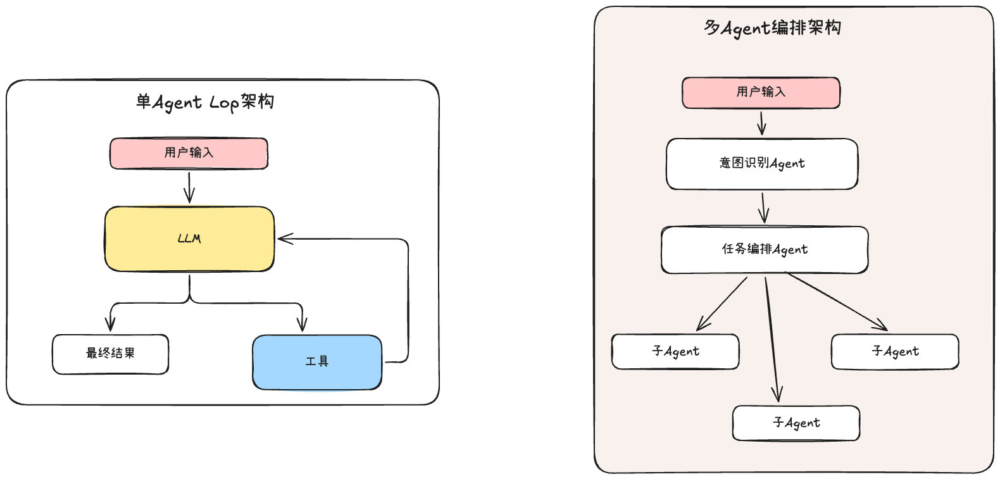

1. 单智能体的架构，

2. 将高频使用的指令放入到系统提示词中，

3. 能够按需加载Skill的能力，

4. 拥有调用现有系统的工具

> 一个处于标准智能体循环中的模型：围绕目标进行推理、探索上下文、通过工具采取行动、通过技能学习流程、提出澄清性问题，并观察结果，直至目标达成
> 
> 其前方没有用于分割对话的意图路由器，后方也没有一组特定领域的智能体
> 
> 


一些参考分析资料：

- 《高效商务智能体结构指南》：https://claude.com/blog/the-anatomy-of-effective-commerce-agents

- 《案例项目》：https://github.com/anthropics/commerce-agents/tree/main

## 一、上下文工程的设计

### 1.1、Skills，而非子智能体

电商领域的对话是一个跨多个意图和轮次的紧密会话，是需要大量共享上下文的，对于上下文的完整性是有很高的要求的

如果为了拓宽上下文的窗口，我们选择使用子Agent的方式来实现的话，不是一种最佳的思路，主Agent和子Agent的每一次任务移交都是一次上下文有损操作，也会导致一些上下文在不同的栈中重复，不是一种高效使用的方法

并且电商领域的任务很少能分离干净，例如：**退货流程可能需要订单历史、当前购物车和产品目录。**

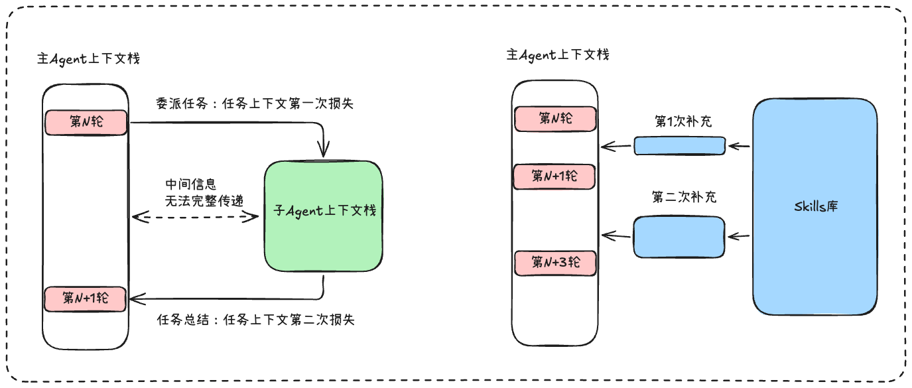

最好的方式是：**使用Skills为Agent提供领域模块化的上下文，让这些丰富的知识渐进式的加载进入上下文中。**


子Agent在我们熟知的搜索研究的方向很有优势，除了可以提供庞大的上下文窗口之外，还可以并行不同方向的探索，让整个研究流程更为广泛。

> 一个常见的生产环境示例是深度研究子代理，子代理在其中搜索和阅读文档、编写并运行代码、遍历数据模型，并走入死胡同。所有工作都在一个或多个子代理内部完成，只有一份精简的答案返回给编排器。
> 
> 

具体关于多智能体的架构设计，我有单独整理过2篇文章：

- https://mp.weixin.qq.com/s/Arzj8Unz1lQz4g_4_ClfOw

- https://mp.weixin.qq.com/s/CkqpUBczmLNhVnUkBIDK6A


这里给大家补充一个小知识点：主Agent和子Agent的交互方式可以总结为：交接（hand-off）和委派（delegation）

- 交接（hand-off）：领域代理直接成为用户的对话对象。它接管整个会话，通过自己的循环持续与用户协作，直到任务完成。编排者（orchestrator）退居幕后，不再转述每句话。

- 委派（delegation）：编排者始终是用户的对话对象，领域代理只是"临时工"——在同一轮对话内被调进来、干完活又退出去，结果经编排者转述给用户。


```TypeScript
前提：因为一次商务对话是一个跨多个意图和轮次的紧密耦合会话，需要大量共享上下文。
原因：每次向子智能体移交都是一次有状态损失的操作，这往往会影响子智能体回复的质量，进而影响整体回复。除此之外，每次移交可能消耗数倍的 token，并增加数秒的延迟。

具体场景的理由：**这些领域也很少能干净地分离。退货流程可能需要订单历史、当前购物车和产品目录，**这意味着按领域划分的子代理方式要么在各处重复这种访问，要么在任务中途交接。


子智能体的优势：
子代理真正能发挥价值的地方，在于编排器可以将其作为工具调用，用于处理一个狭窄或自包含的任务，而这类任务能够受益于拥有自己专用的上下文窗口。

总结：区别在于对话的所有权。交接让领域智能体成为用户的对话方，而委托则保留编排者的主导地位，在一个回合内让领域智能体反复进出，且每次交互都会导致性能下降。

多智能体协作的两种模式（可以记录到文档当中去）：
这段话在讲多智能体架构中让"专用领域代理"干活的两种方式：
交接（hand-off）：领域代理直接成为用户的对话对象。它接管整个会话，通过自己的循环持续与用户协作，直到任务完成。编排者（orchestrator）退居幕后，不再转述每句话。
委派（delegation）：编排者始终是用户的对话对象，领域代理只是"临时工"——在同一轮对话内被调进来、干完活又退出去，结果经编排者转述给用户。
"在每次交互中逐渐降级" 指的是委派模式的问题：领域代理没有连续的对话所有权，每次进入/退出都要重新接收上下文，转述会丢失细节、状态难以延续，多次来回后信息越来越失真、效果越来越差，就像"传话游戏"。
核心观点：如果领域代理有自己独立的合规体系/专门能力（如药房、金融），应该完整交接给它，让它拥有对话并直接面对用户，而不是让编排者夹在中间反复转达。这与你第一段提到的 deep-research 子代理场景恰好相反——深度研究这种工作适合委派（内部折腾再多，只需把精简答案交回编排器，因为答案不依赖后续交互）。判断标准就是：谁拥有这段对话的最终控制权和连续性。
```


### 1.2、指令的位置设计

一组指令是放入到系统提示词中还是Skill中是根据**使用频率**来决定的。

1. 该指令如果是“硬规则”，每一次LLM回复都会使用，那么就放入到系统提示词

2. 根据评估数据来设计，经常加载到的指令可以放入到系统提示词中

> 这取决于你的流量分布方式，以及你的评估所显示的智能体行为。一个不错的起点是：凡是与你三分之一或更多流量相关的内容——无论是在上线前预判到的，还是在生产环境中观察到的——都放入系统提示词，其余内容则放入技能中
> 
> 


下面是电商领域中的具体案例：

1. 关键指令，**如安全和法律规则、品牌约束，以及用户的关键事实（如过敏信息）**，始终放在系统提示中

2. 购物智能体的提示词包含基础设定、购物车与结账语义以及展示规则，而以下技能则涵盖其余部分：搜索发现、购买调研、规划目标、客户关怀和记忆个性化。

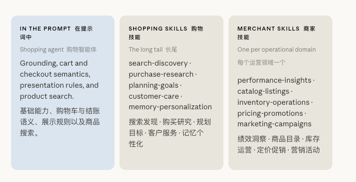


### 1.3、Agent的工具设计

关于Agent中的工具设计的详情，我整理过两篇文章单独讲解Agent的外部数据和工具的设计，感兴趣的伙伴可以去看看

- https://mp.weixin.qq.com/s/1iv_4Jyp3G7i2sUZx_31ww

- https://mp.weixin.qq.com/s/sIrbB4WXMbauY4GPDmk3PQ


在这里我们就电商领域的Harness的工具设计进行梳理，主要就两点核心思路：**在现有的核心系统之上构建工具 和 工具结果是上下文**

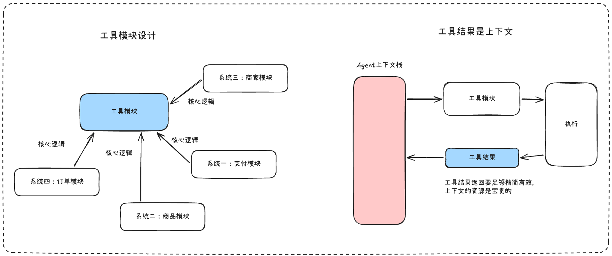

一家商业公司已经拥有搜索和排序、购物车、偏好与档案存储、库存系统、促销与活动引擎、销售分析等，**每一项都编码了经过多年调优的逻辑，并能看到模型永远无法获取的信号**，代理的工具应调用这些系统，而非重新实现它们，工具边界正是其逻辑终止、模型判断接管之处。


工具的结果是要进入到Agent的上下文中的，所以要学会梳理精简工具的返回结果，不要一股脑的把结果丢进去，先把无关的信息去掉，例如：一些图片的url等。

同时要切记工具结果返回的错误信息，不要简单的返回code之类的，例如：402，403这种，**而应该是更详细的错误信息**，可以提供给LLM进行推理调整的内容


### 1.4、界面组件也是工具

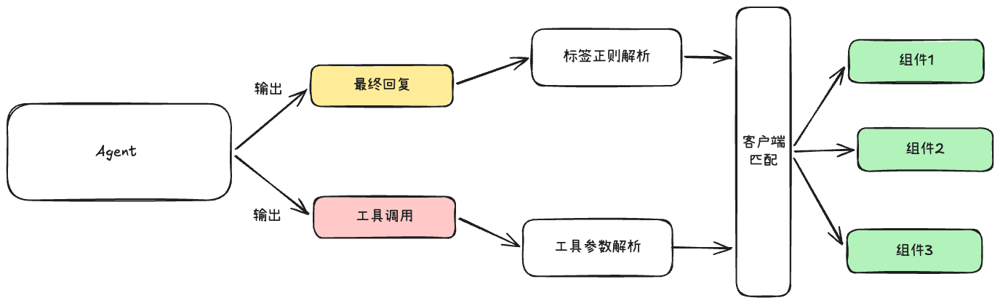

让Agent在回复的时候使用客户端的组件，这个在电商的场景下是很常见的需求，Agent不能仅仅输出文本，还要输出一些组件：产品轮播图、行程安排、图表等

实现方式有两种思路：

1. **自定义标签**：让Agent在最终回复的时候，使用我们定义好的标签，用标签包裹数据，前端接收到输出之后进行标签层面的解析，这样就可以根据标签知道渲染哪一个组件，根据标签内的数据知道如何渲染组件。

2. **工具定义**：将组件定义为工具提供给Agent，就像Coding Agent中的Read、Glob工具渲染的感觉，这样Agent就会输出工具调用的指令给前端，前端就可以正常的解析渲染出来。


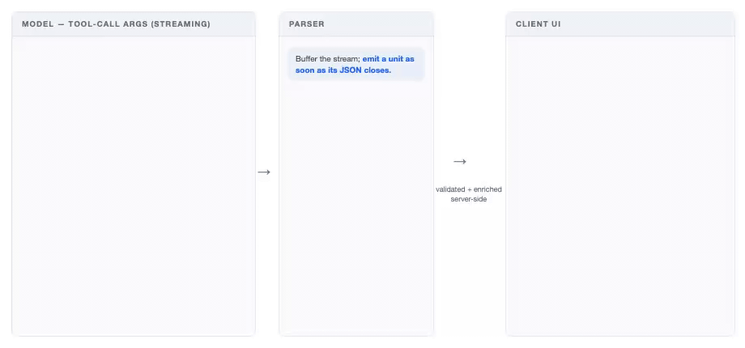

在原文博客中，作者更偏向于第二种的方式，理由是：

- 模型对于自定义标记语言训练的没有工具调用那么充分，因此如果组件嵌套的比较深，那么标签的数据结构会变得复杂，Agent的可靠性会下降。

- 标签定义存在于系统提示词中，每新增加一个组件，系统提示词都会增加一部分，而每一次编辑系统提示词可能会影响其他部分的指令。

- 前端的会话历史记录解析，自定义标签的方式需要客户端重新解析原始消失，而工具调用就可以正常渲染消息流

**我认为这两种方式技术差别其实不是很大，**工具的定义和系统提示词的定义最终都是上下文发送给LLM，而前端渲染解析只是方便一些而已**。**

**我觉得可以“从Agent视角”去思考这个设计会更好一些**，自定义标签对于Agent来说，是要求它每次输出都注意这些自定义标签的指令，而工具定义的话，对于Agent来说，这些组件都是它可以任何调度的东西，数据获取是工具，数据展示也是工具，区别不会太大

我觉得工具定义组件的方式，会让Agent更舒服一些，调用渲染起来会更可靠一些。


## 二、Harness Engineer的设计

上下文工程师Harness Engineering的一部分，只不过我觉得从上下文工程去梳理会更清晰，接下来是一些关于Agent运行空间的设计思路了


### 2.1、延迟

想一下吧，你在输入自己的任务之后，点击回车发送之后，没有任何响应，只有一个圈圈在转来转去，中间没有任何输出，让你等待了1分钟才把整个结果输出来。

这个时候用户第一个感觉是“很卡”，这么卡的东西靠谱吗？用户都不知道它做了什么.

所以Agent输出中间过程，不仅仅是体感上会快一点，更重要的会加强用户的信任，有了信任就会有更多的沟通可能。

> 任务完成延迟是模型各轮次中，生成最后一个 token 所需时间加上工具处理时间的总和
> 
> 


Agent工程师可以从下面这三个角度去调整延迟：**更少的轮次、更快的工具、更合适的模型。**

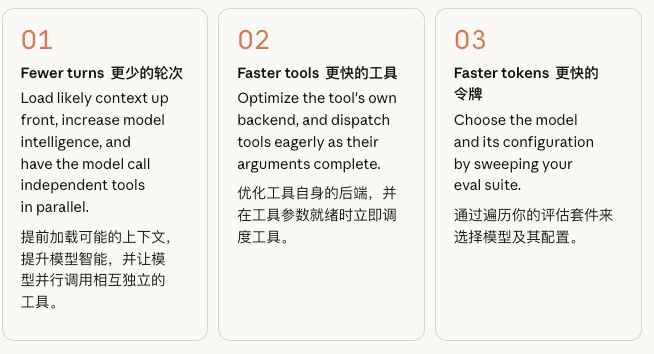


 🎃**更少的轮次的工程优化方式：更智能模型、并行调用工具、预先加载上下文**

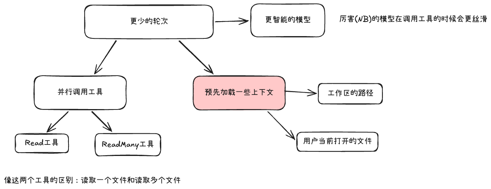

我突然想到一个常见的例子来更好的理解这个更智能的模型的感觉：

就像复习期末考试一样，你当然可以把整本书背下来，那考试你肯定会过的，就像Agent当然可以把所有的文件都读取一遍，肯定可以找到答案的。

你也可以选择画一画重点，先复习重点，先复习经典简单的知识点，难的要花时间的，你可以最后看一看，就像数学试卷一样，简单和中等的题目分数捡一捡，及格是可能的，要是细心一点也能考的不错

Agent也是如此，先调用List工具看看文件列表什么情况，在根据文件名和文件格式优先读取可能性比较大的文件，用户要是输入数据分析相关的，那么Agent优先读取csv格式的文件肯定是最优的。


关于预先加载一些上下文，可以看看ClaudeCode早期的时候，会在左侧显示出来你在VsCode中当前打开和选中的文件，是这种感觉。

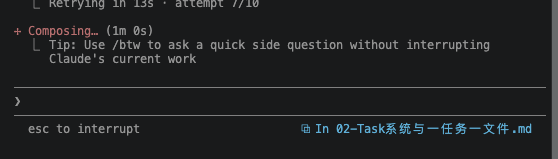


🎃**更快的工具的工程优化方式：调整工具执行函数、积极分发工具**

1. 调整工具执行函数：不要将大量的多后端的判断编排在工具的执行函数中，可以将这些复杂的业务逻辑统一实现在业务服务器的后端，Agent的工具执行函数这边只需要调用这业务服务器的这一个函数就可以

2. 积极分发函数：LLM是流式输出工具调用指令的，不要等待全部工具输出完成在统一调用这些工具，而是流式输出一个完整的工具指令，就可以开始执行这个工具了

原文博客中的这张图非常好，很清晰展示积极分发函数感觉

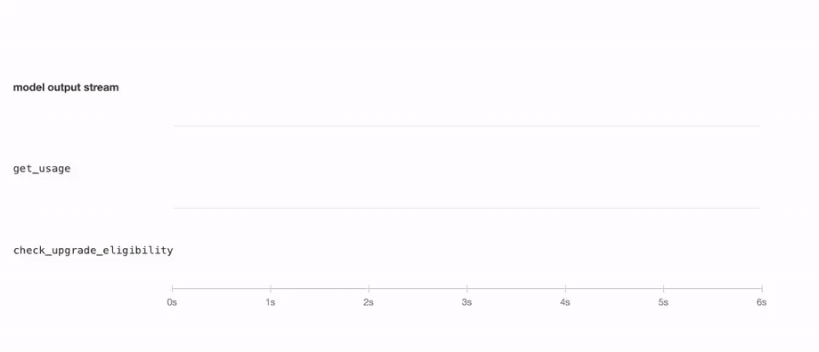


🎃 **感知延迟的工程优化方式：展示中间的推理执行过程和流式输出**

在模型最终回复的时候，可以考虑流式输出，也就是我们经常说的打字机效果，在体感上用户会感觉很快。

现在的很多Agent都会进行推理和工具调用，前端设计不要隐藏这些中间过程，可以把思维链展示出来，同时工具的调用和执行状态也可以显示。


### 2.2、成本

对于Agent的成本调整的工程方法，目前比较成熟的是缓存，提高缓存的方式也很简单，只要遵守这个原则就可以：**改变频率低的上下文尽量放到前面去。**

> 提示词缓存是你最大的成本削减手段，而电商流量非常适合使用它。缓存输入 token 的读取成本仅为全新 token 的十分之一，虽然缓存写入大约有 1.25 倍的溢价，但缓存前缀在第二次使用时就能收回成本
> 
> 


还有第二种方法，但是当前不是很成熟，我没有实际实践过，但是理论是可行的，**多智能体的架构设计**，有很多案例的：

1. 子智能体可以选择使用廉价的模型

2. 在开发的时候，我们可以选择推理能力强的，贵的模型来做计划，当计划审核完成之后，在执行的时候我们可以选择便宜的模型

我比较在意的地方是：**多智能体的上下文管理的复杂度会很高**，理论上可行的东西，在实际Agent这种半黑盒的东西中，可能会产生偏差。当然这个方向也被我纳入探索学习的方向啦，目前正在安排中，未来可能会单独整理一篇文章来说明一下

> 衡量每个已完成任务的成本，而非每次模型调用的成本，因为一个需要更多轮次或更频繁失败的更便宜的模型，并不更便宜
> 
> 


### 2.3、记忆

在电商领域的Harness的设计中，记忆模块是至关重要的。

> 记忆让智能体能够在上次对话中断的地方继续，而不是从零开始。一位在三月提到过坚果过敏的购物者，不应该在六月还要重复一遍；一位每周一都查看同样三个广告活动的商家，也不应该每次都要逐一说出它们的名字
> 
> 

**构建一个记忆模块它会包含三个部分：长期记忆的存储，记忆的写入和读取**

> 不要依赖系统内存中的上下文去存储你的记忆，而应该有一个单独的系统来放置它们。
> 
> 

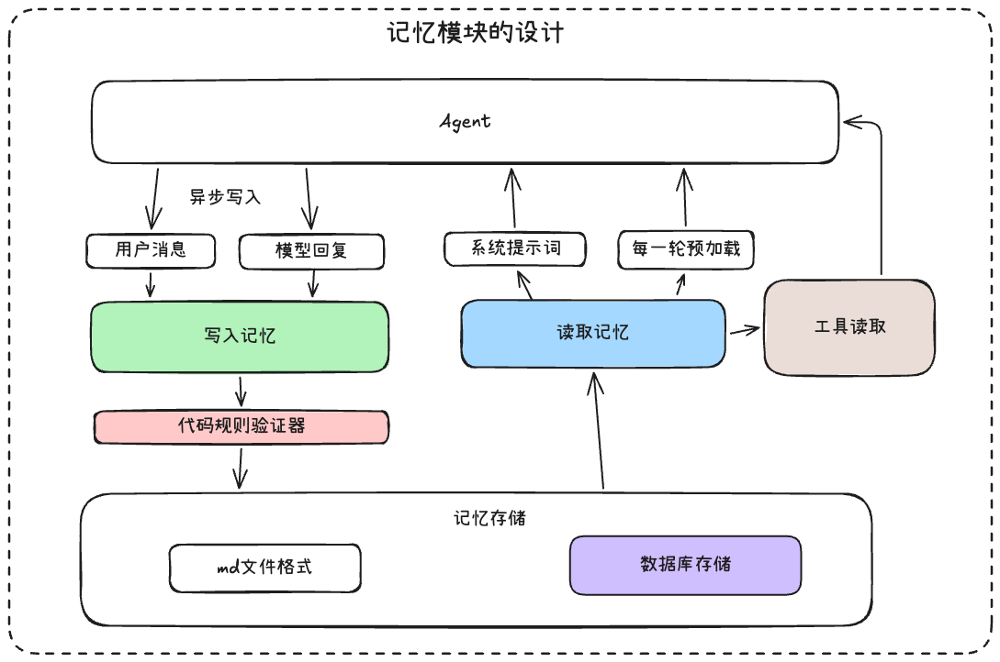

在**记忆存储的设计中**，如果数据量不大并且Agent是唯一的读取方，那么md格式的文件是可行的，但是在电商领域中，相关Agent的数据很快会变得庞大，这个时候可以直接使用业务中已经存在的数据库。只需要调整一下字段而已，增加一个会话来源id等。

> 电商领域的数据库是更成熟的，存储基础设施更好，使用的起来会让Agent更稳定
> 
> 

记忆的存储内容不能仅依靠提示词去做指令的约束，我们在数据存储进入之前，需要使用一些固定规则的验证器在判断一次。

记忆也是会过期的，过期的记忆加载进入会导致上下文污染，所以我们的**记忆存储要提供更新和删除的操作，同时给记忆设置一个过期时间，可以按照年来设置**


**记忆的写入**要在不打断正常的Agent Loop循环去做这件事情，可以在每几轮循环之后触发异步写入，如果设计一个写入工具来做这件事，在电商Harness领域不是最佳的方式，除了会增加循环延迟，还会让循环执行链多出一些不相关的推理信息。

**还有一个关键点，写入记忆的输入只有用户消息和模型回复消息，工具结果不进入**


读取记忆的话，就比较简单了，总共就三种方式

1. 将记忆直接放入到系统提示词，这样每一轮都可以生效

2. 将读取记忆设计成为一个工具，让模型根据需要去主动读取

3. 放入到预加载上下文中，这个比较特别，在上下文即将发送给LLM的时候，根据当前的请求去动态的获取一些记忆注入到上下文中，在发送给LLM。


### 2.4、安全

在电商领域中，我们不能完全相信提示词，因为提示词是可以被绕过和注入危险命令的。

电商领域会涉及到资金这种不可逆的操作，我们只将提示词作为安全的起点，其他的还要依靠成熟的业务服务。

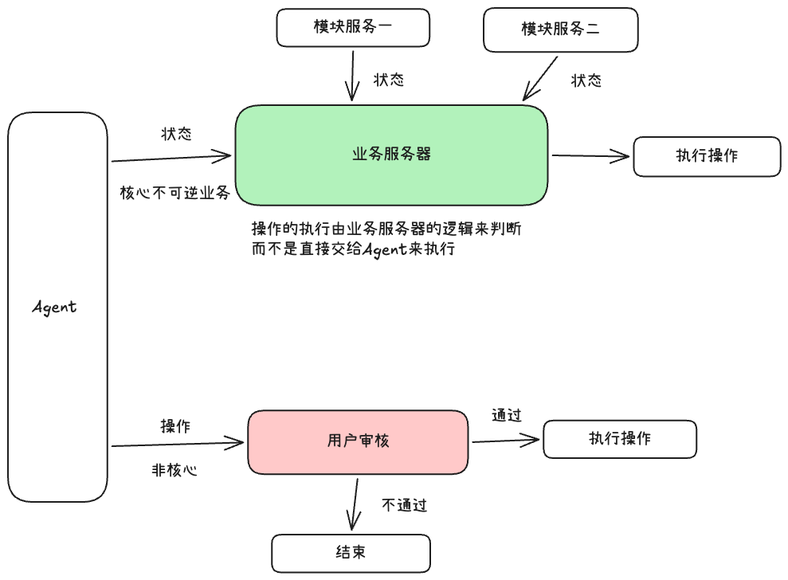

在一些不可逆的操作中，**Agent只做判断，真正的执行交给业务服务器状态来判断，如果Agent真要执行一些操作的时候，一定要经过用户的审核才可以**


在设计电商领域的Harness中，不要完全相信Agent提供的状态和结果

1、对于Agent的输入，首先在Agent能拿的上下文之前先根据我们的业务服务器做一层筛选，将Agent的入口的信息完全控制在稳定的业务服务器这边

> 写入和渲染仅接受服务器颁发的 ID：购物车只接受服务器返回给本次会话的商品 ID，商家工具只接受智能体实际读取过的商品列表和活动 ID。任何其他途径得来的 ID——无论是幻觉生成的、用户粘贴的，还是植入在评论中的——都会在后端看到之前被拒绝
> 
> 第三方内容经过净化处理：在商业场景中，大部分上下文是由并非你的人撰写的——卖家、评论者、竞争对手——因此每一次后端读取都是不可信输入，并且都要经过同一个净化器
> 
> 


2、对于Agent的输出，要经过其他的业务服务器做验证，相同的情况下才开始执行。

> 设有上限的交易必须能够承受重复请求：大多数商业界面都会限制单个用户对某件商品的购买数量——无论是出于票务配额、促销定价还是欺诈控制的需要——而代理会以人类点击按钮时从未有过的方式重试、改述并并行发起请求
> 
> 


### 2.5、评估

任何Agent都需要有评估存在，评估会伴随整个Agent的生命周期，关于详细的评估方法，我之前有单独整理过一篇文章，感兴趣的伙伴可以去看看

https://mp.weixin.qq.com/s/3VqbQzT9ruRVP9B4jlFAEg


这里我们重点梳理和电商领域有关的评估行为和方式

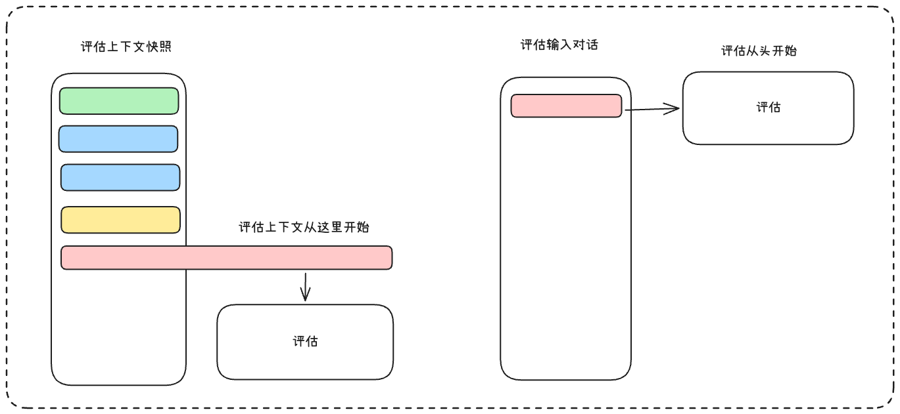

电商领域的评估不能像Coding Agent那样，去设计一个输入，一个期望输出，然后借助测试代码去做评估。

相应的Agent评估要考虑整个上下文状态，也就是我们经常收集的上下文快照，借助这些中间状态来评估，而不是从头开始执行去评估

> 例如：要测试“购物车已经有 3 张票，用户再加 2 张时，Agent 会不会突破 4 张的限购”，不必每次从“你好，我想买票”开始聊。
> 
> 


还有评估数据集是需要和一些领域专家合作进行设计的，你也可以这么理解，任何新的领域的评估数据集开始都是从人手动设计开始，并且是根据已存在的业务数据开始设计专属的评估数据集。

> 与那些能亲眼看到失败的一线主题专家合作设计测试用例，例如产品、法务、商户运营、客户服务和品类管理团队的成员。真实的失败案例是最好的评估素材，每个用户流程准备 50-100 个评估用例是一个不错的起点。
> 
> 


关于评估的方法和方面，我们可以从以下这几点考虑：

1. 评估要覆盖不同类型，有正向用例也应该有负向用例

2. 首先要评估请求多的业务的，这些业务影响面是比较广的

3. 前端渲染的界面也需要评估

4. 评估流程的完整性，在电商领域整个业务请求中，执行链路是比较长的，会涉及到多个模型，我们不能仅评估一个模块的完成就是成功，我们要结合整个流程来统一做评估验证

5. 还要评估出现错误会带来金钱和信任损失的场景
