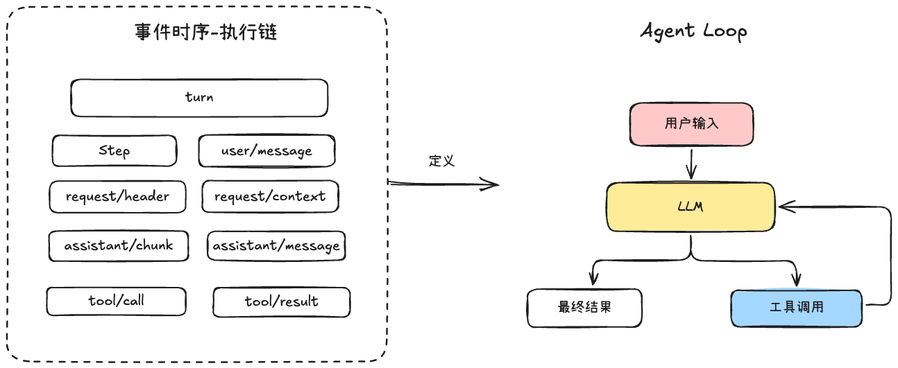
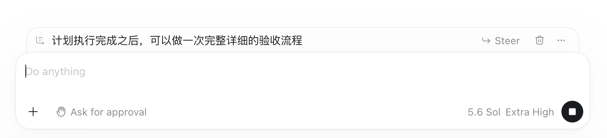
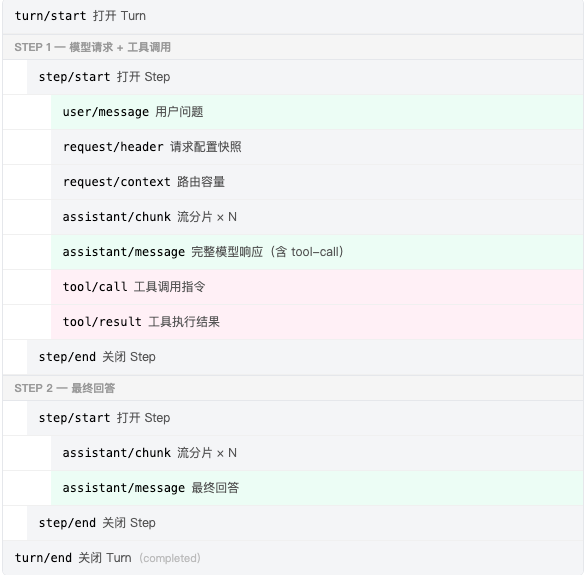
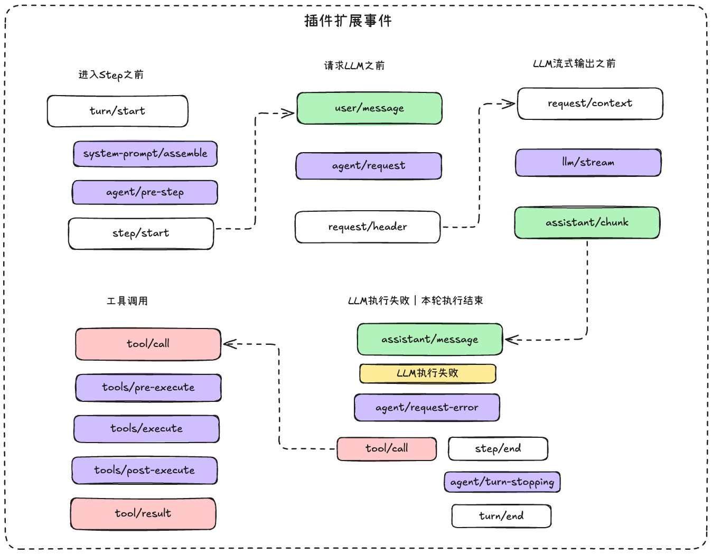
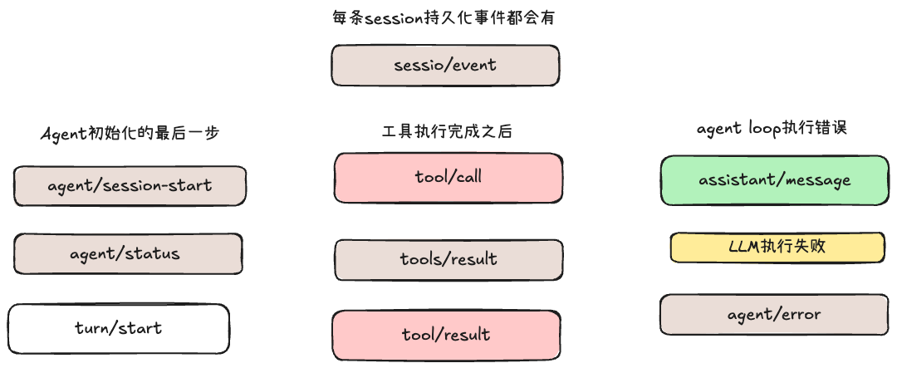
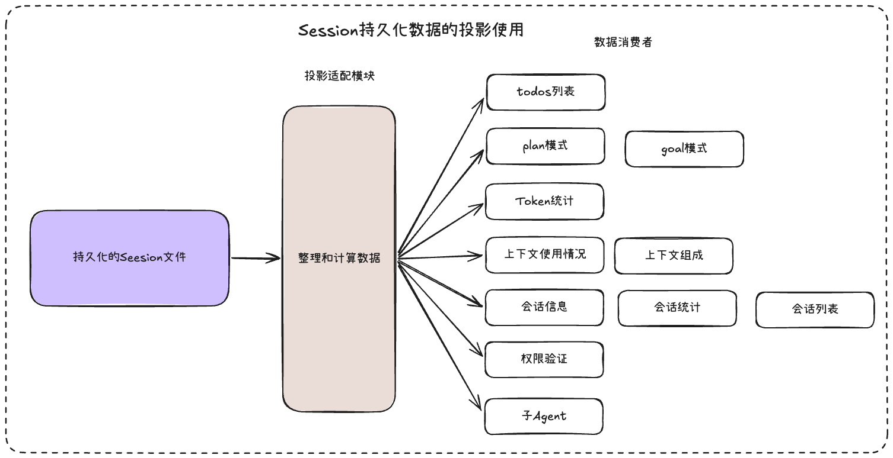

# DSH的宝藏之一：Session持久化的设计

## 一、Session持久化事件



在梳理真正的执行顺序之前，我们先来了解一些比较有趣的设计思路，

第一个有趣的设计是在`user/message`的事件中，消息来源有两种，**用户直接输入和插件注入的上下文**。

插件有两种方式将上下文送入`user/message`：一是通过inject直接注入一条UserMessage；二是通过systemPrompt.context注册动态上下文，Agent在发送消息给LLM前拼接系统提示词时会将其注入




用户输入是有三种注入的方式的：followup、steer、inject

- followup表示的是下一个turn进入，进入消息队列等待，和上图的感觉一样

- steer表示的是消息补充，进入到下一个step，类似于在codex中发送消息之后，按下command+回车强制在执行流程中插入一条消息

- inject和steer类似，唯一的区别是inject是静默的，不会主动唤醒Agent，而followup和steer进入队列之后会立即唤醒Agent


第二个有趣的设计：`assistant/message`输出调用工具指令的时候和`tool/call`内容是非常类似的，那为什么要单独定义一个tool/call呢？直接让assistant/message和tool/result结对就行

我觉得从设计层面去理解会更好，`assistant/message`表示模型输出节点，而`tool/call`是工具执行前置条件，如果没有`tool/call`，那么Agent的执行链路就会很“隐性”，复杂度会藏在代码后面，显式地拆出来，节点是增加了，但链路更清晰了。

当然，有了`tool/call`之后，工具的执行时间戳是独立的，崩溃恢复是有据可查的，配对的`tool/call`和`tool/result`也能降低因消息格式错误导致模型调用失败的概率。


第三个有趣的设计我觉得是`request/header`，它的详细格式如下：

```TypeScript
export interface EpochHeader {
  config: LlmCallConfig
  adapterDefaults?: LlmCallConfigAdapterDefaults
  system?: string
  tools?: ToolSchema[]
}
export interface LlmCallConfig {
  provider: string
  model: string
  reasoningEffort?: ReasoningEffortId
  temperature?: number
  maxTokens?: number
  stop?: string[]
}
```

把系统提示词和工具定义全部都放进去了，同时还增加了模型的配置，除了message之外，几乎是一次完整的LLM请求参数的记录

这个记录到日志中之后，并不会每一次请求都写入一次，而是在里面的信息有变动的时候才会追加写入到session持久化文件中，否则多次LLM请求都是读取同一份内容


那么接下来我们就一起来看看，这些事件完整的在整个Agent Loop的顺序设计




## 二、插件扩展点事件



DSH的设计原则是“一切皆插件”，所以在整个Agent Loop执行链路中，提供了插件的可扩展点

用户在创建插件的时候，是可以去改变执行链路和Context的，只要去订阅相应的插件事件就可以，非常的方便，接下来我们就详细聊一下每一个事件扩展点

1. `system-prompt/assemble`：是一个waterfall事件模式，可以在这里组装系统提示词，动态上下文和工具列表，下面大部分都是waterfall事件模式，有next函数

2. `agent/pre-step`：这里是执行的门禁，决定是否进入Step，并且是带什么消息进入，在这里如果最终返回reject类型，那么整个执行就中断结束，直接turn/end

3. `agent/request`：插件可以在这里改变模型的供应商，型号和一些配置参数，**它不能修改消息**

4. `llm/stream`：插件可以包装或者替换自定义的流式迭代器

5. `agent/request-error`：模型请求失败后的恢复，一般在这里控制模型的重试过程

6. `tools/pre-execute`：这里是工具执行前的权限校验，有三种返回值，allow、deny、ask，如果插件想接手工具的权限模块，那么可以在这里注入相应的信息

7. `tools/execute`：其包装了实际的工具执行函数，可以在这里做一些超时，重试等方式

8. `tools/post-execute`：可以操作工具的结果，决定工具结果以什么形式交给模型，所以插件可以在这里替换内容，做一些标记之类的

9. `agent/turn-stopping`：Turn即将关闭的最后机会，这个是唯一的serial事件模式


## 三、通知事件

DSH中的通知事件蛮多的，可能差不多13种，都是emit事件模式，我这边先只梳理和主执行链路有关的5种通知事件，感兴趣的伙伴可以去DSH种的源码做更多的深入探索



`agent/session-start`订阅事件可以获取到完整的Agent对象的信息和启动信息，`agent/status`是用来**获取当前的Agent状态是已经结束还是执行中的**，也能够获取完整的Agent对象

`tools/result`事件可以拿到工具执行链路中完整的信息，有工具执行结果和工具执行参数，非常全，但是只能获取不能修改

`agent/error`是可以获取到Agent执行链路中比较详细的错误信息

```TypeScript
{
  agent: Agent,       // 哪个 Agent 出错了
  turn: number,       // 在第几个 Turn
  step: number,       // 在第几个 Step（如果不在运行中则为 0）
  error: unknown      // 错误对象本身
}
```

`session/event`的作用是每当一条持久化事件写入到session存储中时，就立刻通知所有的订阅函数，其可以获取到Session的基本信息和完整的写入数据，主要是用来作为前端显示推送的，或者驱动各种统计和投影的重新计算


## 四、Session持久化数据的投影使用



并且在适配模块中实现的时候，也非常的优雅，使用了三个函数在决定一切的操作行为，init函数、apply函数、view函数

**init函数负责数据结构的初始化，apply函数负责在接受到更新行为的时候，如何进行计算和操作，view函数负责控制展示哪些数据给前端使用**


这种方式就可以保证真正的唯一数据源，就是session持久化文件，类似于一个Agent的数据底座，Agent的上下文由这个数据源决定，前端的显示行为，是一种投影，不能作为Agent自进化的核心考虑，所以将投影显示设计为“只读操作”，所有的投影适配器原始数据都来源于同一份

我刚开始探索这个的时候，就想到这个将Agent的上下文作为整个Harness最核心的东西，其余的都是显示操作，将开发专注力放到Agent读取上下文的那一刻，也就是这个Session持久化文件应该放什么东西，怎么设计，有点像上下文来驱动整个Harness启动
